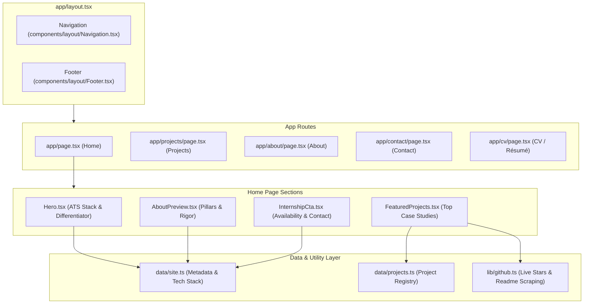
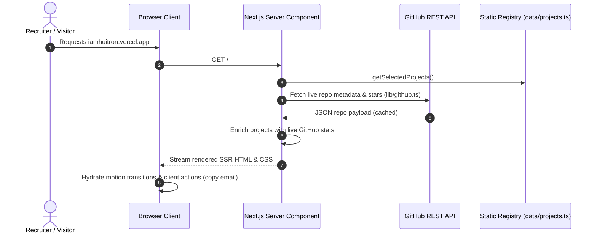

# 🏛️ Portfolio Architecture & System Topology

High-performance personal engineering portfolio built with Next.js 15 App Router, React 19, and Tailwind CSS v4. Designed with an editorial, Swiss-style architectural aesthetic and strict data modeling.

---

## 1. Technology Stack

| Layer | Technology | Details |
| :--- | :--- | :--- |
| **Framework** | Next.js 15 (App Router) | Server Components by default, selective Client Components |
| **Language** | TypeScript 5 (Strict Mode) | Full type safety across data layers and props |
| **Styling** | Tailwind CSS v4 | OKLCH color spaces, CSS variables, `@theme` tokens |
| **Motion & Animation** | `motion/react` | Smooth signature bezier easing, zero bouncing AI gimmicks |
| **Icons** | `lucide-react` | Monochrome, semantic stroke icons |
| **Data Fetching** | GitHub REST API | Cached star counts and repository metadata |
| **Deployment** | Vercel Edge Network | Global CDN edge caching |

---

## 2. System Topology & Component Graph



---

## 3. Data Flow



---

## 4. Directory Structure & Module Responsibilities

```
portfolio/
├── app/                  # Next.js App Router (pages, layouts, metadata)
│   ├── globals.css       # Design tokens, ledger-grid texture, OKLCH palette
│   ├── layout.tsx        # Base HTML shell, custom webfonts (Fraunces, Space Grotesk)
│   ├── page.tsx          # Home page composing Hero, Featured, About, CTA
│   ├── projects/         # Full project archive with search/filter
│   ├── about/            # Extended background, UNAM Informatics & audit experience
│   ├── contact/          # Direct contact channels and scheduling
│   └── cv/               # Printable web CV / Résumé
├── components/           # Reusable UI component library
│   ├── layout/           # Global Navigation and Footer
│   ├── sections/         # Composed page sections (Hero, FeaturedProjects, CTA)
│   └── ui/               # Atomic primitives (ProductCard, Chip, ButtonLink)
├── data/                 # Source of truth for portfolio content
│   ├── site.ts           # Site identity, socials, ATS keywords, contact
│   └── projects.ts       # Structured case study catalogue
└── lib/                  # Utilities & API clients
    ├── github.ts         # GitHub repository metadata and image resolvers
    └── utils.ts          # Class merging and formatting utilities
```
